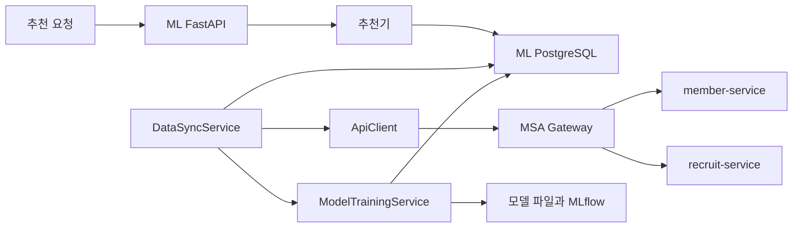

# 구조와 변경 영향

[문서 목차](README.md) · [개발 절차](development.md) · [검증 기준](verification.md)

이 문서는 현재 코드의 구조를 설명한다. 배포 환경에서 전체 흐름을 실행한 결과는 아니다.
LLM API·Kafka·pgvector로 바꾸는 제안은 [RAG 추천 설계안](../.local/plans/rag-recommendation.md)에 있다.

## 작업 공간

| 경로 | 역할 | 원본 근거 |
|------|------|-----------|
| `cobee-msa/` | 회원·모집·알림과 서비스 인프라 | [Gradle 모듈 목록](../cobee-msa/settings.gradle) |
| `cobee-ml/` | 모집글 추천, 데이터 동기화, 모델 학습 | [API 진입점](../cobee-ml/src/api/main.py) |
| `docs/` | 공통 개발·검증·계약 안내 | [문서 목차](README.md) |
| `graphify-out/` | 정적 분석 지도와 검토 근거 | [Graphify 규칙](../AGENTS.md#graphify) |

MSA는 Java 21과 Spring Boot를 사용한다. ML 단위 검증 환경은 Python 3.11이다.
정확한 버전은 빌드 파일과 [Python 의존성](../cobee-ml/requirements.txt)을 확인한다.

## MSA의 역할과 의존 관계

- `member-service`: 회원, 인증, 프로필, 선호도, 회원 동기화, 탈퇴 작업과 복구.
- `recruit-service`: 모집글, 지원, 북마크, 댓글, 모집 데이터 동기화, 회원별 쓰기 상태.
- `alarm-service`: 알림과 푸시 연동.
- `chat-service`: 채팅 서비스 모듈.
- `apigateway-service`: HTTP 라우팅과 인증 필터.
- `config-service`: 외부 설정 제공.
- `eureka-server`: 서비스 등록과 탐색.
- `common`: 공통 응답, 오류, 동기화 키 검사, 외부 연동 도구를 담은 라이브러리.

`common`은 독립 실행 앱이 아니다. [빌드 설정](../cobee-msa/common/build.gradle)에서 `bootJar`를 끄고 `jar`를 만든다.
현재 `alarm-service`, `member-service`, `recruit-service`가 이를 참조한다. 변경 시 이 모듈들을 함께 검사한다.

일반적인 코드 위치는 `controller → service → repository`이다.
`domain`은 저장 모델, `dto`는 요청·응답 모델이다. 서비스 간 HTTP 호출은 `client`에서 찾는다.
이 방향은 코드 탐색 기준이다. 현재 자동 의존성 검사 도구로 강제하지는 않는다.

## 탈퇴와 모집 쓰기의 순서

탈퇴 접수는 회원 상태를 WITHDRAWING으로 바꾸고 `withdrawal_job`을 함께 저장한다.
작업자는 Redis 차단, 모집 DB 차단과 정리, 토큰 삭제, 회원 삭제를 단계별로 수행한다.
회원 삭제와 작업 완료는 같은 회원 DB 트랜잭션이다. 원격 HTTP는 이 트랜잭션 밖에서 호출한다.

모집 쓰기는 같은 트랜잭션에서 `member_write_state` 행을 잠근다.
쓰기와 탈퇴 차단이 같은 행에서 순서를 정한다. 차단 전에 커밋한 쓰기는 정리 대상에 포함한다.
차단 뒤에 잠금을 얻은 쓰기는 거부한다. 이 검사로 Gateway를 이미 지난 요청도 처리한다.
회원·지도·파일 준비와 알림 호출은 쓰기 잠금 밖에 둔다.

| 코드 | 책임 |
|---|---|
| [WithdrawalStore](../cobee-msa/member-service/src/main/java/org/example/memberservice/withdrawal/WithdrawalStore.java) | 접수, 처리권 선점, 단계 기록, 회원 삭제와 완료 |
| [WithdrawalWorker](../cobee-msa/member-service/src/main/java/org/example/memberservice/withdrawal/WithdrawalWorker.java) | 미완료 단계 실행과 재시도 |
| [MemberWriteGuard](../cobee-msa/recruit-service/src/main/java/org/example/recruitservice/withdrawal/MemberWriteGuard.java) | 호출자의 쓰기 트랜잭션에서 상태 행 검사와 잠금 |
| [RecruitMemberLifecycle](../cobee-msa/recruit-service/src/main/java/org/example/recruitservice/withdrawal/RecruitMemberLifecycle.java) | 영속 차단과 반복 가능한 데이터 정리 |
| [MemberAccessChecker](../cobee-msa/apigateway-service/src/main/java/org/example/apigatewayservice/filter/MemberAccessChecker.java) | Gateway의 비동기 Redis 접근 상태 검사 |

내부 서비스 자격과 대상 회원 ID는 별도 값이다. 새 내부 경로는 `X-Internal-Key`를 검사한다.
Redis는 새 요청을 차단한다. 최종 모집 쓰기 순서는 모집 DB가 보장한다.
적용 순서, API 변경, 삭제 범위는 [탈퇴 운영 절차](withdrawal.md)를 따른다.
실제 PostgreSQL·Redis의 로컬 결과와 HTTP 대역 범위는 [검증 기록](../diagnostics/2026-10-31/withdrawal-tdd/README.md)에 구분한다.

## ML의 역할과 의존 관계

| 변경 내용 | 먼저 볼 위치 |
|-----------|----------------|
| 추천 API와 응답 | [라우터](../cobee-ml/src/api/routers/recommendations.py), [API 스키마](../cobee-ml/src/models/schemas.py) |
| MSA HTTP 요청 | [ApiClient](../cobee-ml/src/clients/msa_backend_client.py) |
| 동기화와 DB 반영 | [DataSyncService](../cobee-ml/src/services/data_sync_service.py), [동기화 스키마](../cobee-ml/src/models/sync_schemas.py) |
| 추천 점수 | [HybridRecommender](../cobee-ml/src/recommender/hybrid_recommender.py), [scoring.py](../cobee-ml/src/recommender/scoring.py) |
| Phase 선택 | [phase.py](../cobee-ml/src/recommender/phase.py), [갱신 스크립트](../cobee-ml/scripts/update_phase.py) |
| 학습과 모델 저장 | [ModelTrainingService](../cobee-ml/src/services/model_training_service.py) |
| 환경·정책·테이블 | [설정 로더](../cobee-ml/src/utils/config_loader.py), [정책 설정](../cobee-ml/config/config.json), [초기 SQL](../cobee-ml/database/init.sql) |

추천 결과는 모집글이다. 회원은 추천을 요청하는 사용자이다.
`scoring.py`와 `phase.py`는 환경 설정과 DB 없이 불러올 수 있다.

## 호출과 쓰기 흐름

화살표는 호출 또는 쓰기 방향이다. HTTP 전체 흐름은 아직 통합 검증하지 않았다.

동기화 코드는 5개 API를 병렬 조회한다. 새 데이터가 있으면 ML DB를 갱신하고 커밋한 뒤 학습 흐름을 호출한다.
이후 마지막 동기화 시각을 파일에 저장한다. 댓글의 저장 경로와 증분 시각 처리에는 [확인 필요 항목](contracts/sync.md#확인-필요-항목)이 있다.

## 실행 시 생기는 작업

- 설정 로더는 모듈을 읽을 때 환경 설정을 생성한다.
- DB 모듈은 모듈을 읽을 때 Engine을 생성한다.
- API 시작 코드는 Phase 갱신과 시간 단위 동기화 예약을 등록한다.
- 동기화는 DB, 모델, MLflow, 상태 파일을 변경할 수 있다.
- Compose는 PostgreSQL과 Redis를 정의한다. 현재 추천 코드에는 Redis 캐시 연결이 없다.

따라서 빠른 단위 검증과 앱·DB·학습 통합 검증을 나눈다. 실행 명령과 범위는 [검증 기준](verification.md)에 있다.
